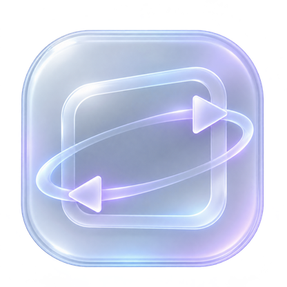
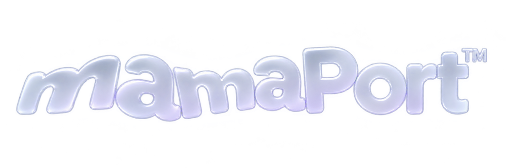

 

<strong>Build Apple TV game packages from Windows.</strong>

[GitHub Releases](https://github.com/Mama-Labs/MamaPort/releases) � [Setup](#setup) � [Build a game](#build-a-game) � [Help](https://github.com/Mama-Labs/MamaPort/issues)

MamaPort is a Windows desktop app for building tvOS packages from your own compatible 64-bit Nintendo Switch game dumps. Use it to check the toolchain, choose game settings and cover art, and sign and install an IPA on your Apple TV 4K.

## Setup

1. When the Windows prerelease is published, download **MamaPort-Windows-x64.zip** from [Releases](https://github.com/Mama-Labs/MamaPort/releases) and extract the entire folder to a writable location. A short folder path helps with the build toolchain.
2. Install [64-bit Python 3.12](https://www.python.org/downloads/windows/) with Tcl/Tk and the Python launcher, then open **MamaPort.exe**. First launch uses the internet to install the app's Python packages.
3. Install the [x64 .NET 10 SDK](https://dotnet.microsoft.com/download/dotnet/10.0), [LLVM for Windows](https://github.com/llvm/llvm-project/releases) with both `clang.exe` and `ld64.lld.exe`, the [LunarG Vulkan SDK](https://vulkan.lunarg.com/sdk/home#windows) with `spirv-cross.exe` and `glslangValidator.exe`, and Apple's [Metal Developer Tools for Windows](https://developer.apple.com/metal/tools/). The development setup used LLVM 23.1.4 and Metal 6.2. If `zstd.exe` is missing, download the [Windows zstd ZIP](https://github.com/facebook/zstd/releases) and extract the `zstd-*` folder beside MamaPort.exe.
4. Download the Xcode 27.1 `.xip` directly from [Apple Developer Downloads](https://developer.apple.com/download/all/). In MamaPort choose **Extract SDKs** and select the archive. This can take a while. You can also supply already extracted device SDK folders using the paths below. Apple's terms apply to its downloads and SDKs.
5. Reopen MamaPort after installing your tools. Select **Check setup** and resolve any required items listed in the log.

Expect several gigabytes of tooling and enough free space for the original game, its temporary extraction and shader cache, and one or more IPA copies. Keep games and keys outside the app directory. The first game build may fetch the LibHac package from NuGet.

Use **Setup  Tool locations** for custom installations. For Vulkan, choose its `Bin` folder. For LLVM, choose the parent of `bin`. For SDKs, choose the device `.sdk` folders. Keep game dumps, keys, and signing credentials outside the app directory.

## Build a game

1. Open **Build** and choose the folder containing one base dump and its update. Select your console keys and an output IPA. Cover artwork and game settings are optional.
2. Click **Build tvOS IPA**. A first build can take hours, depending on shader compilation and the title. Set aside storage for the dump, build cache, and output package.
3. Review **Activity** for progress or error details. Use **Copy log** when asking for help and redact private paths and identifiers before sharing.

## Sign and install

1. Use an Apple TV 4K with tvOS 26 or later and Developer Mode enabled. Connect your PC and Apple TV to the same network.
2. On the TV, open **Settings  Remotes and Devices  Remote App and Devices**. In MamaPort, open **Install** and select **Pair Apple TV**.
3. Use **Sign IPA** with a tvOS provisioning profile, its matching `.p12` identity, and [rcodesign](https://github.com/indygreg/apple-platform-rs/releases). The profile must authorize the Apple TV, bundle identifier, and entitlements. You can also supply an IPA signed using compatible tvOS tooling.
4. Select **Install signed IPA** and launch the app from the Apple TV Home Screen.

Mario Kart 8 Deluxe and Super Mario Odyssey ran on the original Windows build. Compatibility depends on the title, update, and Apple TV model. Mario Kart 8 Deluxe requires a 64-bit update (2.0 or later). This Windows package is a prerelease.

## Source and credits

MamaPort builds on [TVPort](https://github.com/68hctmzzjf-svg/TVPort), the [nxnative](https://github.com/seedds/nxnative) engine, and [NXNativeWindows](https://github.com/zenvyzenshiro/NXNativeWindows). For the original macOS app, see [TVPort's releases](https://github.com/68hctmzzjf-svg/TVPort/releases). MamaPort is independent of Nintendo and Apple.

Windows release archives contain application source and build support, with no game dumps, keys, Apple SDKs, or signing credentials. The Windows launcher is unsigned. To build the launcher on Windows, run `python package_release.py` from the Windows source folder.
